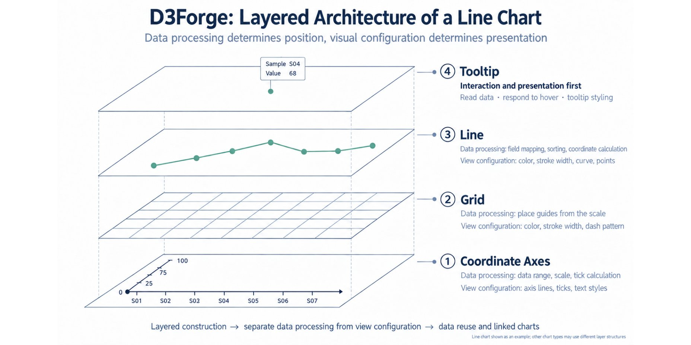

<div align="center">
  
  <h1>D3Forge</h1>
  <p><strong>Build your chart. Take the native D3 code.</strong></p>
  <p>Configure charts visually, preview changes live, and export standalone D3.js code.</p>
  <p><a href="README.zh.md">简体中文</a> · <a href="README.md">English</a> · <a href="README.ja.md">日本語</a></p>
  <p>
    <a href="https://wan9h5.github.io/D3Forge/">Live demo</a> ·
    <a href="#quick-start">Quick start</a> ·
    <a href="#features">Features</a> ·
    <a href="docs/architecture.md">Architecture (Chinese)</a> ·
    <a href="https://github.com/wan9h5/D3Forge/issues">Report an issue</a>
  </p>
  <p>D3 v7 · React · TypeScript · MIT</p>
</div>

---

## About D3Forge

D3Forge is a frontend-only visual code builder for D3.js. Choose a chart, customize it with sample data or a local CSV file, and take the complete source into your own project.

**Common settings are ready to use. The rest is yours to explore.** Each chart starts with practical defaults. Additional applicable options are grouped in advanced sections and disabled by default, so you can enable them as needed. Each chart has its own controls, expanded through real use cases and community contributions. Every adjustment produces corresponding native D3 code.

The desktop workspace has three columns: **configuration → live preview → read-only source**. The preview executes the generated source itself. Exported code depends only on D3 and DOM APIs and can run in other web projects.

## The idea behind D3Forge

D3Forge began with two things. My boss was enthusiastic about D3 and believed it could be used to create wonderfully engaging tools, so he encouraged me to learn it. As I studied D3, I found that its many APIs were difficult to keep in mind, and even a simple chart could take a lot of code. I realized chart code could be understood through two layers: a **data layer**, which maps fields and calculates positions, and a **visual configuration layer**, which controls how the chart looks. In D3, axes, grids, lines, and tooltips can then be composed as separate visual layers. That observation led to D3Forge: make these choices easier to explore visually while keeping the resulting native D3 code visible and reusable.

<p align="center"></p>

We use a line chart as a compact model with four visual layers:

1. **Coordinate axes** — data processing determines the range, scale, and ticks; view configuration controls axis lines, ticks, and text styles.
2. **Grid** — data processing places guides from the same scale; view configuration controls color, width, and dash patterns.
3. **Line** — data processing maps fields, sorts observations, and calculates coordinates; view configuration controls color, width, curve, and points.
4. **Tooltip** — interaction selects a row and formats its values; view configuration controls hover behavior and tooltip styling.

Each layer keeps data processing separate from view configuration. That separation makes the source easier to read, lets users change presentation without changing data semantics, and gives each chart only the controls that make sense for it. This is the design foundation for adding more scientific and bioinformatics examples through community contributions.

The line-chart example is intentionally simple: change a data mapping or a visual setting, see the preview update, and locate the corresponding source change. D3Forge applies the same layered idea to scatter, volcano, heatmap, survival, Circos, composition, and other chart families.

## Features

- **Chart library** — Browse by chart family; every example includes deterministic sample data.
- **Search and categories** — Find examples by chart name or family in Chinese, English, or Japanese.
- **On-demand loading** — Gallery cards render thumbnails near the viewport, cache completed SVGs, and fill in the rest as you scroll or filter.
- **Visual configuration** — Adjust mark size, opacity, colors, axes, grids, legends, and tooltips.
- **Immediate source feedback** — Changes update the chart and locate and highlight the corresponding code lines.
- **Source reader** — Separate tabs for D3 logic and data, syntax highlighting, line wrapping, and `Ctrl+F` search.
- **Complete export** — Copy or download a `.js` file containing both drawing logic and current data.
- **Local CSV** — Parse, map fields, and preview data in the browser without uploading files.
- **Three languages** — Switch between Chinese, English, and Japanese; the app remembers your choice and translates generated comments too.
- **Product home** — Interactive demonstration, quick start, and usage guidance.

### Supported chart families

| Chart | Purpose | Capabilities |
| --- | --- | --- |
| Scatter plot | Compare two numeric variables | Group colors, linear/log scales, labels, zoom and pan |
| Volcano plot | Show effect size and significance | `−log10(p)`, significance classes, threshold lines |
| Box plot | Compare distributions across groups | Quartiles, median, 1.5 × IQR whiskers, outliers |
| Bar chart | Compare categories and composition | Grouped/stacked, horizontal/vertical, signed values, value labels |
| Line chart | Show change over time or sequence | Multiple series, smooth curves, points, area fill, linear/log scales |
| Violin plot | Compare distribution densities | Bandwidth, horizontal/split/half/raincloud layouts, subgroups, facets, box summaries, jittered observations |
| Manhattan plot | Show chromosome association significance | Chromosome order, cumulative position, alternating colors, significance/suggestive thresholds, labels |
| Heatmap | Compare matrix values | Long-form mapping, mean/sum for duplicate coordinates, sequential/zero-centered diverging colors, numeric legend |
| Histogram | Inspect a variable's distribution | Equal-width bins, counts/density, maximum included in the last bin |
| Pie / donut | Show categorical composition | Pie/donut/sector, angles and corner radius, leader labels, center text |
| Pie matrix | Compare composition across rows and columns | Long-form mapping, independent cell proportions, gaps for missing combinations, consistent category colors |
| Nested pie | Show two-level categories | Parent/child records, automatic parent totals, aligned child angles, donut variants |
| Waffle | Represent proportions with equal units | Squares/dots/person icons, adjustable grid, largest-remainder allocation, exact proportions in tooltips |
| Bar of pie | Inspect one parent's composition | Parent pie, selectable category, child bars, guide links |
| Bar with pies | Compare totals and composition together | Sample total bars, per-sample category pies, independent proportions |

### Research result plots

The **Research statistics** category includes seven plots for scientific results:

| Chart | Required input | Controls |
| --- | --- | --- |
| Forest plot | Study label, estimate, lower and upper interval limits | Linear/log effect scale, reference, row order, interval/value display, groups |
| ROC curve | False-positive rate and true-positive rate in [0,1] | Model groups, random-classifier diagonal, points, line style |
| Precision–recall curve | Recall and precision in [0,1] | Model groups, points, line style |
| Funnel plot | Effect estimate and positive standard error | Effect scale, reference, study labels, groups; smaller SE at the top |
| GWAS Q–Q plot | P values in (0,1], optional cohort and SNP labels | Uniform-null plotting positions (i−0.5)/n, −log10 axes, groups and diagonal |
| Regional association | Chromosome, position and P value; optional precomputed r² | Chromosome/region selection, LD colors, P-value reference and SNP labels |
| Species accumulation | Positive integer sample counts, supplied richness summaries, optional lower/upper limits | Grouped curves, supplied interval bands, points, colors and axes; no resampling or richness estimation |

These plots do not fit models, pool studies, infer confidence levels, or calculate AUC/AP or bias tests. Forest intervals must satisfy lower ≤ estimate ≤ upper; log scales require positive values. Curves connect supplied coordinates without creating endpoints. Data panels provide downloadable example CSVs, required-field checks and current row-filter counts. All exports remain standalone D3 v7 code with the input data included.

### Genomic Circos tracks

The Circos category also includes **Genomic Two-track Circos Bars**, which positions two nonnegative tracks by supplied chromosome lengths and 0-based half-open intervals. Track scales can be shared or independent. This is distinct from the categorical two-track circular bar example; reference lengths must agree, and intervals are not automatically aggregated or binned.

### Scatter extensions and 3D

Examples cover joint analysis, grouped regression, fold change, equations and R², marginal distributions, bubble matrices, ranked points, density, motif results, paired observations, continuous color, GSEA NES/FDR, correlation, and categorical/gradient 3D scatter. Each has dedicated field mappings and controls. Confidence bands, size mapping, and point borders can be enabled as needed.

Scatter examples use 6–36 deterministic records to demonstrate configuration. Downloads include the data array and complete drawing, statistical, and interaction logic. Replace the data while keeping the mapped field names. The 3D charts implement projection, depth sorting, rotation, and zoom with D3 and SVG, without an additional runtime dependency.

- Numeric scatter: two numeric fields, optionally labels, categories, size, and continuous color; 3D adds a third numeric field.
- Bubble matrix: row category, column category, nonnegative size, and color value. Duplicate coordinates are not automatically aggregated.
- Paired scatter: subject ID, condition, value, and optional cohort. Repeated observations within the same cohort, subject, and condition are averaged.
- GSEA combination: pathway, NES, and FDR (0–1). HOMER/motif charts take previously computed significance and enrichment results.

Regression supports linear and quadratic models. Optional 95% confidence bands use 200 paired bootstrap resamples with a fixed seed and show pointwise intervals for the mean curve, not individual prediction intervals. Pearson/Spearman charts do not generate P values; Spearman uses average ranks for ties. Upstream analyses such as GSEA, HOMER, and PCA are not performed in the browser.

### Survival, Circos and chromosome charts

Eleven new entries reuse existing Manhattan, circular heatmap and two-track circular bar support. The sidebar adds survival, Circos and chromosome families; SNP LD is under heatmaps. Basic styles are ready to use, with optional risk tables, tests, annotations and other controls.

| Chart | Default fields | Main controls |
| --- | --- | --- |
| Kaplan–Meier | `subject, time, event, group` | 90/95/99% confidence intervals, censor marks, risk table, log-rank |
| Exploratory best cutoff | `subject, time, event, score` | Manual/median/maximum log-rank scan, minimum group proportion |
| Gene-labeled Circos | `chromosome, length, position, end, gene, group` | Proportional sectors, leaders, coordinate ticks, label limit |
| Fusion Circos | `chromosome, length, position, targetChr, targetLength, targetPos, gene, group, weight` | Link visibility, support-weight widths and filtering |
| Receptor–ligand Circos | `source, target, ligand, receptor, weight` | Directed ribbons, strength filter, arrows, cell names |
| SNP linkage disequilibrium | `chromosome, snpA, position, snpB, targetPos, r2` | Chromosome, LD color limits, SNP labels and values |
| SNP density | `chromosome, length, position` | Window size, count/per-Mb density, orientation, color scale |
| Chromosome loci | `chromosome, length, position, gene, group` | Radius, orientation, track thickness, annotations |
| Chromosome ideogram/peaks and segments | `chromosome, length, position, end, gene, group` | Interval colors, shared physical scale, orientation, thickness |
| Segments with centromeres | Interval fields plus `centStart, centEnd` | Centromere outlines, segments, coordinates, assembly note |

- **Survival:** one row per subject, nonnegative time, `event=1` for an event and `event=0` for right censoring. IDs are optional; all duplicates are excluded when mapped. Tied events and censors share the risk set, with events counted first. KM uses Greenwood log-log intervals. No delayed entry, competing risks or covariate adjustment.
- **Exploratory cutoff:** scan midpoints between unique scores, requiring at least two subjects per group and the selected minimum proportion. Report candidate count, raw P and Bonferroni-adjusted P. This is not the `maxstat` procedure; an in-sample optimum needs independent validation.
- **Coordinates:** supply reference lengths from one assembly and 0-based half-open `[position,end)` intervals. Loci allow `0–length`. Conflicting lengths/centromeres and out-of-range intervals are excluded. Mock lengths are illustrative, not a real species. Cytobands, fusions and peaks are not inferred.
- **SNPs and associations:** LD accepts precomputed `r²` or `|D′|` in [0,1]; duplicate pairs use the mean and conflicting SNP positions are excluded. No genotype-to-LD analysis. Density counts one locus per row, includes empty windows and uses actual terminal-window length. Receptor–ligand links aggregate positive supplied strengths; sectors encode incoming plus outgoing totals.
- **Export and languages:** deterministic data, calculations, layout and tooltips are included in standalone D3 + DOM source. Replace mappings while preserving visual controls. UI and generated comments support Chinese, English and Japanese.

### Heatmap extensions

17 new styles cover clustering, circular clustering, matrices, calendars, paired triangles, selected gene labels, cluster cuts, clinical metadata, row/column annotations, trends, trends with terms, text marks, summary bars, paired panels, dot/stem cells, symbols and Sankey links. Each provides relevant mappings and controls with practical defaults and optional advanced settings.

- **Input**: long-form `sample, gene, value`; calendars use `date, value` with strict `YYYY-MM-DD` dates. Additional columns supply metadata, a second value, size or link weight.
- **Clustering**: Euclidean, Manhattan or `1 − Pearson` distances; average, single or complete linkage; cuts by cluster count. Disconnected observations join last and constant-vector correlations use explicit deterministic rules.
- **Normalization**: row/column population Z-scores, constant vectors mapped to zero, missing cells left blank. Duplicate coordinates use mean or sum. Paired panels aggregate separately and share color limits.
- **Combinations**: categorical/numeric annotation tracks, two-metric triangles, row mean/sum bars, cluster trends and flow-conserving Sankey ribbons. Trends follow column order and break at missing values. Conflicting metadata displays `mixed`. Terms, marks and weights display supplied results without enrichment or significance testing.
- **Export**: clustering, layout and interaction logic are included in standalone D3 + DOM source. Chinese, English and Japanese descriptions and code comments follow the selected language.

### Volcano extensions

Twelve entries cover gene annotations, gradients, linked pairs, VIP, hyperbolic thresholds, cell clusters, two/four-class colors, marker facets, radial clusters, category annotations, interactive exploration, and three-color volcano plots. Each has dedicated controls, deterministic data, and three-language guidance. Common settings are ready; additional options can be enabled as needed.

- Base input is `gene,log2FC,pvalue`; map raw or adjusted P values and the axis will name the selected field. Add nonnegative `VIP` for size, `category` for functional colors, or `cluster`/contrast for grouped layouts. Duplicate records remain; no differential analysis or multiple-testing correction is performed.
- Labels prioritize P values or a supplied gene list, with limits, collision avoidance, and leader lines. Linked panels offer contrast selection and shared/independent ranges; only gene names unique within both panels are connected.
- The explicit exploratory hyperbola is `|x| > FC` and `−log10(P) > −log10(P threshold) + a / (|x| − FC)`. Drawing and classification use the same formula; it is not a statistical test or FDR control.
- Cluster plots encode log2FC by within-cluster horizontal offset and signed `−log10(P)` vertically. Radial layouts encode log2FC by within-sector angle and signed significance by inward/outward distance from a reference ring. No single-cell analysis is run.
- VIP is proportional to area above the minimum marker area. Continuous color maps significance or a numeric field; category color applies only to points passing the filter.
- Gene search, brush counts, and click-to-pin labels are included in native D3/DOM exports. Search and brushing only highlight; they do not filter or change exported data. Brush mode is separate from hovering, clicking, and zooming.

### Bar and histogram extensions

An initial set of 18 entries covers error bars, two-track circular bars, linked percentage composition, butterfly, vertical, polar, grouped, dot, stacked, horizontal stacked, 3D, bottom aggregation, extruded, diverging, horizontal grouped, triangle, broken-axis bars, and histograms with fitted curves. Each includes small deterministic data, dedicated mappings, and Chinese/English/Japanese controls and source comments.

- Category bars use long-form `category,series,value` data. Series is optional; duplicate combinations can be summed or averaged. Diverging bars preserve input signs; percentage and radial layouts require nonnegative values.
- Error bars can calculate means, sample SD, SEM, or Student t 95% confidence intervals for the mean from repeated observations. No error estimate is made for `n < 2`. Summary data can map center/lower/upper fields, with one row per category/series combination. No significance tests are generated.
- Histograms take one numeric field. Equal-width bins support counts and probability density; normal approximations and kernel density curves use matching vertical units. A normal approximation is not a normality test.
- Dot bars offer unit size and column controls; a final partial unit is encoded by dot area. Percentage links show composition changes, not individual flows.
- Two-track circular bars select inner/outer series and shared or independent ranges. They do not parse genomic coordinates. 3D bars use native SVG projection, depth sorting, rotation, and zoom for small categorical matrices.
- Broken axes explicitly mark omitted intervals. Values inside the gap appear as hollow points with original values in tooltips. Bottom connecting surfaces and extruded sides are decorative and encode no additional quantities.

### Dual axes, grouped stacks, and bar shapes

Another 14 entries provide ice-cream, pencil, background stem, up/down, dual-axis bar/line, curved percentage stacks, 2.5D platforms, dual-axis bars, grouped stacks, linked stacks, dual-axis GO, grouped polar, stack/line, and gene up/down layouts. Existing bar/pie, GSEA NES/FDR, and polar entries remain available.

- Dual-axis data uses `category,value,secondary`. Each metric has its own aggregation and scale. The right axis supports a title/unit, tick format, and custom range. The P-value transform accepts only `0 < P ≤ 1`, aggregates first, then computes `−log10(P)`; the aggregate must also be valid. GO defaults to the minimum P value to show the most significant record in a category. This is not a combined P value or an enrichment test. Axis colors identify the metrics; heights cannot be compared directly across axes.
- Grouped stacks use `category,cohort,series,value`: cohorts sit side by side within each category, and components stack within each cohort. Missing combinations become zero; duplicates are summed or averaged. Grouped polar charts place series side by side within category sectors on a shared radial scale.
- Stack links offer straight/curved paths and boundary lines/bands to show aggregate changes of the same component. Stack/line charts average the selected trend field per category and share the stack's numeric axis. Use dual axes for different units.
- Up/down bars place selected nonnegative series above and below zero; lower ticks show magnitudes. Gene up/down bars retain input signs and use direction colors. They do not perform differential analysis.
- Ice-cream sticks, pencil tips, background references, and 2.5D platforms have dedicated controls. Decoration does not move the value-encoding endpoint. Reference values do not cap the data range.

### Composition data

Composition charts accept nonnegative long-form CSV data and sum duplicate categories. Pie/waffle charts need category and value; pie matrices add row and column groups; nested pie and bar-of-pie need parent, child, and value; bar-with-pies needs sample, category, and value. Map your actual CSV column names in the data controls.

Proportions are calculated independently per sample or matrix cell. Nested pies show each parent's share of the total on the inner ring; outer angles follow the parent, and outer percentages are relative to that parent. Waffle units approximate proportions while tooltips retain exact values. Charts display supplied summaries; they do not infer biological categories or run significance tests.

### Choose a style directly

The library has **118 example entries**, organized by scatter, line, bar, box, violin, pie, waffle, histogram, heatmap, volcano, Manhattan, survival, Circos, and chromosome families. Variants are grouped with their family. Open donut, sector, or leader-label styles directly from their cards.

Violin variants use `group,value`, with optional `sex` subgroup, `tissue` facet, and `letter` annotation fields; all column names are configurable. Split violins require exactly two subgroups. Facets share a numeric range by default, with independent ranges available.

Bar, box, and violin charts can read existing letter annotations. Violins also support manual comparison brackets and text. **Statistical tests and P values are not generated. Sample letters and comparison text are illustrative.**

## Quick start

For local development, use **Node.js 22.12+ or 24** and npm.

```bash
git clone https://github.com/wan9h5/D3Forge.git
cd D3Forge
npm ci
npm run dev
```

Open the address printed in the terminal, normally `http://localhost:4173`.

1. Open the chart library and choose a chart.
2. Adjust the controls, or import a CSV and map its fields.
3. Inspect the chart in the center and the D3 source on the right.
4. Copy the complete code or download the `.js` file.

### Use exported source in your project

Install D3:

```bash
npm install d3
```

Run the exported code after the DOM is ready in a project supporting JavaScript modules. It uses an existing `#chart` container, or creates one if absent.

```html
<div id="chart"></div>
```

Exports include the current sample or CSV data. You can replace `const data` while preserving mapped field names:

```js
const data = [
  { sample: 'S01', expressionA: 12, expressionB: 18, group: 'Control' },
  { sample: 'S02', expressionA: 24, expressionB: 31, group: 'Treatment' },
];
```

### Build and deploy

```bash
npm run build
npm run preview
```

Deploy `dist/` to a static host. Navigation uses hash routing.

This repository includes an automatic GitHub Pages workflow. For the first release, open `Settings` → `Pages` → `Build and deployment` → `Source` and select `GitHub Actions`, then push the `main` branch to GitHub. Every later push to `main` rebuilds and updates the site automatically. The published site is <https://wan9h5.github.io/D3Forge/>.

## Development

Stack: React 19, TypeScript, Vite, D3 v7, Zustand, CodeMirror 6, and Papa Parse.

```text
src/
  App.tsx             Routing, navigation, and route chunks
  Home.tsx            Product home and quick start
  Builder.tsx         Three-column configuration workspace
  Guide.tsx           Quick start and usage guidance
  HeroDemo.tsx        Interactive controls/chart/source demo
  Gallery.tsx         Chart families, search, and preview cards
  ChartThumbnail.tsx  On-demand thumbnails near the viewport
  thumbnailScheduler.ts Thumbnail queue and SVG cache
  model.ts            Types, sample data, defaults, validation
  store.ts            Configuration and data state
  generate*.ts        Native D3 layouts, statistics, and source generation
  *Controls.tsx       Progressive chart-specific controls
  *Entries.ts         Library entries, variants, and translations
  Preview.tsx         Isolated execution of generated source
  CodePanel.tsx       Read-only editor, search, highlighting, export
  SiteFooter.tsx      Project and license links
docs/
  architecture.md     Product decisions and architecture (Chinese)
  assets/             README visual assets
tests/                Generation, statistics, and component behavior
```

Validation commands:

```bash
npm test
npm run build
```

See [AGENTS.md](AGENTS.md) for development rules and [Architecture](docs/architecture.md) (Chinese) for design decisions.

## Data and current limitations

- CSV files are processed locally, up to **2 MiB / 10,000 rows**, with lower per-chart limits for expensive layouts. Larger SVG datasets can affect interaction speed.
- Blank/invalid numbers are skipped. Log scales require positive values; volcano charts require `0 < p ≤ 1`.
- Configuration does not persist across reloads. Switching charts restores that chart's default data and controls.
- Configuration changes regenerate the preview and reset its zoom position.
- Bar charts sum duplicate category/series combinations by default, with mean aggregation available. Numeric axes are linear and include zero.
- Line X fields accept numbers or time indices. Convert date strings to numbers first; data is sorted by X.
- Violins use a linear numeric axis and Epanechnikov kernel density estimation with a bandwidth multiplier. Single-point/constant groups use fallback bandwidths; interpret shape alongside sample size.
- Manhattan positions must be nonnegative and P values satisfy `0 < p ≤ 1`. Chromosome spans come from maximum positions in current data, not full reference-genome lengths.
- The default Manhattan threshold of `5e-8` is adjustable. Significant-point labels prioritize the smallest P values and can be limited in number.
- Basic legends use one row; advanced legends support wrapping, vertical layout, position, font size, and visible-item limits. All data remains included.
- D3 logic is read-only; the data tab supports validated JSON editing. Bidirectional logic editing, image export, and component code generation are not currently available.

Previews use bundled D3 in a restricted iframe without an external CDN. Imported strings are rendered as text nodes, and script end tags are escaped in embedded source. Gallery thumbnails use the same generated source, run at most two nearby previews at once, then serialize the SVG into a bounded cache and release the iframe. Before sharing an export, check that its included data is suitable for disclosure.

## Roadmap

- [x] Scatter / Volcano / Box with native source export
- [x] Chart library, three-column workspace, code search
- [x] Product home, interactive demo, quick start
- [x] Lazy gallery thumbnails, SVG caching, and home/route code splitting
- [x] Bar / Line with source export
- [x] Violin / Manhattan with source export
- [x] Heatmap / Histogram and six composition families with dedicated mappings and controls
- [x] Survival, Circos, chromosome, SNP, and association examples with specialized mappings
- [x] Progressive chart-specific controls, multilingual UI/source comments, and local CSV remapping
- [ ] Broader real-browser interaction coverage and large-dataset detail-page performance

## Optional advanced controls

Basic controls remain readily available. Collapsible, initially disabled advanced sections expose applicable axes, domains, grids, labels, legends, reference lines, backgrounds, spacing, and chart-specific styles. Numeric display domains only clip the view; histogram bin ranges filter observations and renormalize density.

## Contributing

Use [Issues](https://github.com/wan9h5/D3Forge/issues) to report bugs and discuss chart requests, or submit a pull request. See the [contribution guide](CONTRIBUTING.md) (Chinese) for extension steps and PR requirements.

Include reproduction steps, expected/actual behavior, browser version, and a minimal dataset safe to share. New charts should reuse the configuration and source-generation flow so that preview and export execute the same native D3 code.

## License

Released under the [MIT License](LICENSE).

## PCA examples

Four dedicated entries cover grouped PCA scores, score/loading biplots, group convex hulls (including triplicates), and rotatable 3D PCA. Import precomputed scores through local CSV and supply explained variance manually. Biplots distinguish `sample` and `loading` rows using a configurable record-type column, with a common display multiplier for both loading components. Scores and loadings must use compatible upstream scaling. Ellipses show sample-covariance dispersion, not confidence regions; hulls show observed sample boundaries. Each entry includes a downloadable deterministic CSV example, and preview and export use the same native D3 source.

The biplot uses actual PCA results for the [UCI Wine dataset](https://doi.org/10.24432/C5PC7J): 178 samples and 13 chemical variables. Features are centered and scaled by sample SD (n−1), scores are ZV, and correlation loadings are V√λ. The first two components explain 36.1988481% and 19.2074903%. Original class IDs are preserved. See [example data and attribution](public/examples/README.md) and the reproducible NumPy preparation script at `scripts/prepare-pca-wine.py`. Source and derived data are CC BY 4.0; app code remains MIT. The other PCA examples remain deterministic synthetic examples.

Importing a PCA CSV disables existing explained-variance labels, so percentages from the previous dataset cannot silently carry over. Enter the new PCA percentages before re-enabling the labels. Two-dimensional PCA uses equal coordinate units by default; three-dimensional PCA uses one shared scale across components.

## Editable example data

The source panel's data tab accepts a JSON array of flat objects. D3 logic remains
read-only. Valid edits apply after 350 ms and feed the same data used for preview,
copy and download. Invalid or incomplete drafts remain in the editor while the
previous valid chart and export are retained. Undo, redo and restoring the chart's
example data are available. Restoring data preserves visual controls. Switching
charts, resetting or importing CSV starts a fresh editing session and cancels any
pending edit. Drafts are local and are discarded when leaving the page.

Keep current field names and mappings. Cells accept strings, finite numbers and
null, without nested values or executable JavaScript. Numerical magnitude is
limited to 10^15, strings to 4,000 characters and field names to 200 characters.
P values, survival status, score/loading row types, genomic coordinates and other
intrinsic chart constraints use the chart's existing validation. Display filters
are kept separate; valid filtered records remain in the exported data. An empty
array intentionally clears a chart. Editing PCA data hides prior variance labels;
PCA is not recomputed.

| Limit | Value |
| --- | --- |
| JSON text / CSV file | 2 MiB |
| General records | 10,000 |
| Distinct fields / stored cells | 100 / 100,000 |
| Heatmap expanded cells | 10,000 |
| Extended heatmap matrix (clustering trees) | 80 rows × 80 columns |
| Automatic survival cutoff scan | 500 records |
| Fusion / ligand–receptor / gene Circos | 2,000 records |
| LD | 150 distinct SNPs |
| Ligand–receptor | 80 distinct cell nodes |
| PCA | 50 groups; 100 loading arrows |
| SNP density | 10,000 expanded windows |
| Pie matrix / bar–pie | 100 panels |

These are conservative browser limits, not statistical sample-size requirements.
The editor shows the applicable rules and rejects oversized edits without silently
truncating records. CSV uploads share the structural limits and retain the
existing field-remapping workflow. Configuration changes that exceed a chart's
computational budget show a message in place of executing that preview.

## Chart color schemes

Primary color controls include a color-scheme selector and a swatch preview. Grouped plots offer Tableau 10, Set2, Dark2, Paired and Category 10; continuous value plots offer Viridis, Cividis, Blues and Magma; diverging heatmaps and volcano status colors offer RdBu, BrBG and PiYG. Native D3 scales or embedded scheme arrays are included in exports and drive the preview. Manual color edits restore Custom mode; existing examples retain their confirmed colors until a scheme is selected. Volcano significance colors and per-category composition overrides retain their semantic roles.
